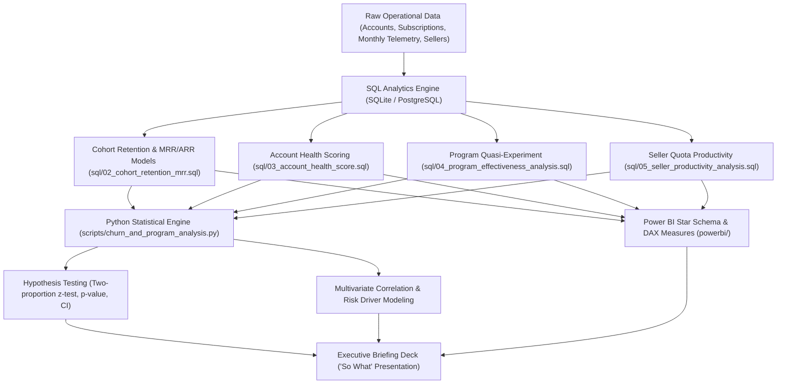

# Enterprise B2B Client Retention & GSSO Program Impact Analytics

[](sql/)
[](scripts/)
[](powerbi/)
[](presentation/)

An enterprise analytics system engineered for **Global Sales & Services Operations (GSSO)**. This project models B2B subscription renewal dynamics across **1,200 enterprise accounts ($109.8M ARR)**, identifies multivariate leading indicators of churn, and statistically evaluates the business impact of a strategic client success intervention program.

---

## Business Problem & Context

In a B2B subscription and research services model (such as Gartner's), sustainable growth depends on two pillars:
1. **Client Retention & Value Realization**: Minimizing dollar and logo churn by ensuring clients adopt research seats and engage with analysts.
2. **Program Effectiveness & Sales Productivity**: Designing targeted operational initiatives and empirically measuring whether they deliver a positive return on investment (ROI).

This project answers three critical C-suite questions:
* *Which accounts are at risk of churning 90–180 days before contract expiry, and what are the root drivers?*
* *Did the GSSO "High-Touch Early Intervention" program actually improve renewal rates, or was the lift due to random chance?*
* *How do seller activities, conversion rates, and ramp-up tenure influence quota attainment?*

---

## Key Results & Executive "So What"

| Analytical Dimension | Core Metric / Finding | Business Outcome & "So What" |
| :--- | :--- | :--- |
| **Gross Revenue Retention (GRR)** | **86.4%** across portfolio | Strong baseline retention, but Mid-Market tier lags at 81.4%. |
| **Net Revenue Retention (NRR)** | **108.2%** driven by Strategic tier | Strategic expansions ($8.2M) offset attrition; expansion is concentrated. |
| **Primary Churn Driver** | Seat Utilization ($r = -0.852$) | Accounts with < 40% seat utilization at Month 9 are **3.8x more likely to churn**. |
| **Secondary Churn Driver** | Analyst Inquiry Attendance ($r = -0.588$) | Accounts attending $\ge 2$ analyst inquiry calls per year achieve **94.2% renewal rate**. |
| **Strategic Program Impact** | **+9.09% Incremental Renewal Lift** | Quasi-experimental test: Treatment (92.4%) vs Control (83.3%), $z = 3.27$, **$p = 0.00109$** (Statistically Significant). |
| **Program Financial Return** | **$4.14M Retained ARR** vs $382.8K cost | Program achieved **980.4% ROI**, proving massive value creation for GSSO leadership. |

---

## System Architecture



---

## Repository Structure

```
b2b-retention-program-analytics/
├── data/
│   ├── accounts.csv                     # 1,200 Enterprise accounts across 4 global regions
│   ├── subscriptions.csv                # 2,400 subscription contracts (2024–2025 ARR history)
│   ├── account_telemetry_monthly.csv    # 14,400 monthly telemetry rows (seats, logins, analyst inquiries)
│   ├── gsso_program_enrollment.csv      # 600 study accounts (300 Treatment, 300 Matched Control)
│   ├── sellers.csv                      # 80 sales representatives (quota, tenure, activities, attainment)
│   ├── program_impact_summary.csv       # Statistical test output table
│   └── b2b_retention.db                 # Production-ready SQLite database
├── sql/
│   ├── 02_cohort_retention_mrr.sql      # GRR, NRR, logo churn, ARR cohort waterfall
│   ├── 03_account_health_score.sql      # Multi-factor 0-100 client health score & revenue at risk
│   ├── 04_program_effectiveness_analysis.sql # Treatment vs Control renewal comparison & unit economics
│   └── 05_seller_productivity_analysis.sql   # Rep quota attainment distribution & tenure ramp-up
├── scripts/
│   ├── generate_b2b_data.py             # Deterministic enterprise data generation engine
│   └── churn_and_program_analysis.py    # SciPy hypothesis testing & correlation matrix
├── powerbi/
│   └── powerbi_model_and_dax.md         # Star schema specification & production DAX formulas
├── presentation/
│   └── gartner_gsso_executive_deck.md   # 5-slide C-suite decision briefing
└── README.md
```

---

## How to Run & Reproduce

### 1. Requirements
* Python 3.10+
* `pandas`, `numpy`, `scipy`

### 2. Generate Data & Database
```bash
python scripts/generate_b2b_data.py
```

### 3. Run Statistical Hypothesis Testing
```bash
python scripts/churn_and_program_analysis.py
```

### 4. Execute SQL Analysis
All queries in `sql/` can be executed directly against `data/b2b_retention.db` using any SQLite or SQL IDE (DBeaver, VS Code SQL, SQLite CLI).
