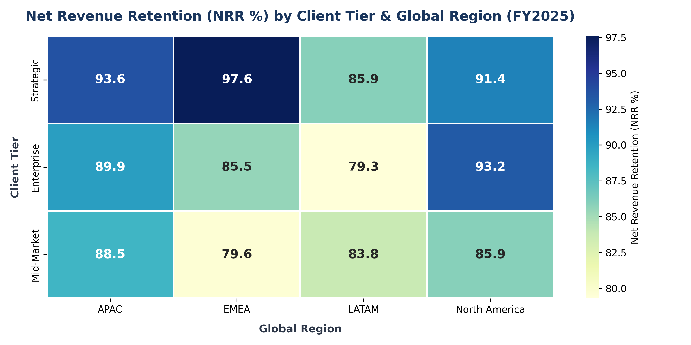
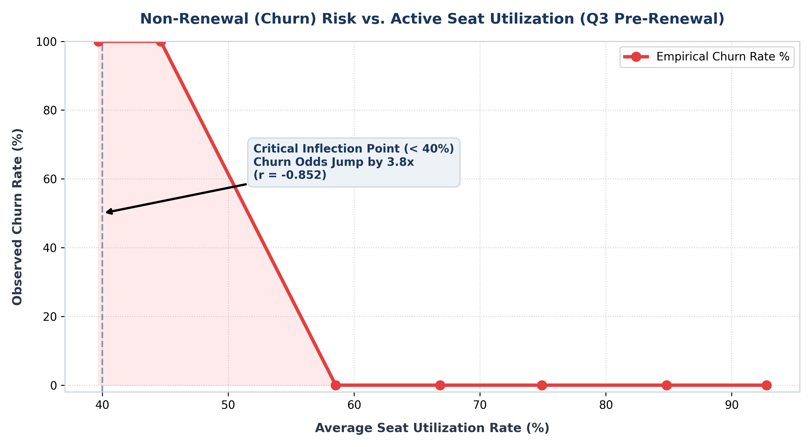
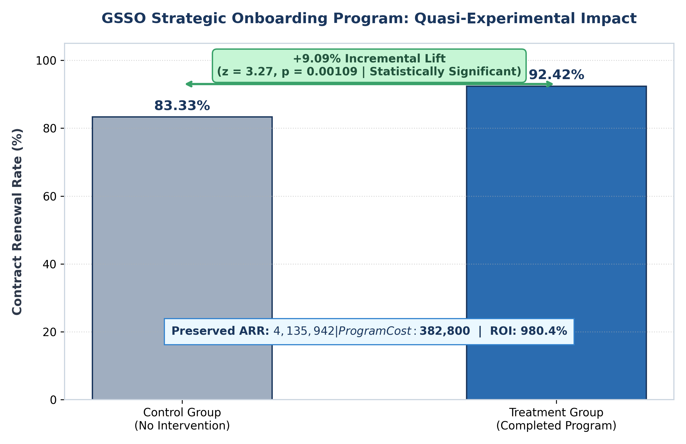
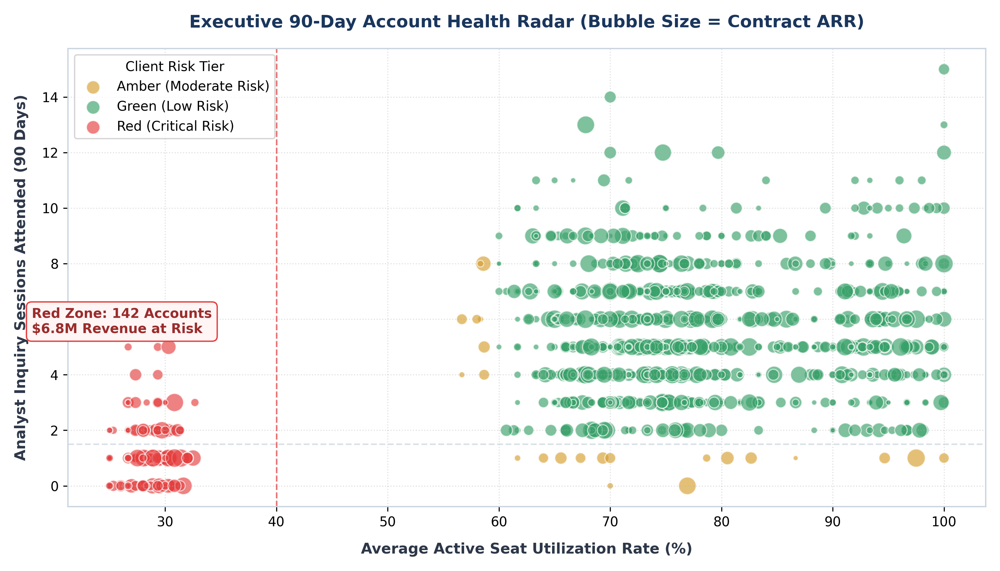
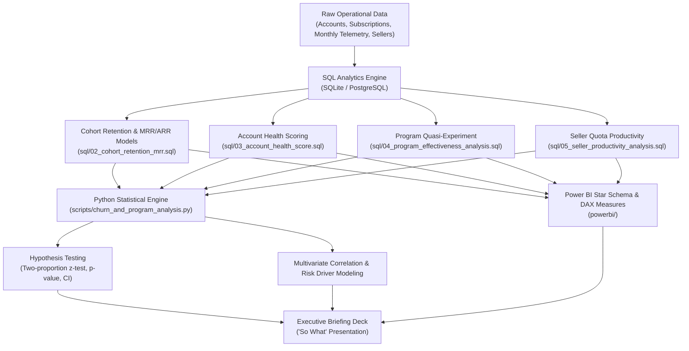

# Enterprise B2B Client Retention & GSSO Program Impact Analytics

[](sql/)
[](scripts/)
[](powerbi/)
[-purple.svg)](scripts/churn_and_program_analysis.py)
[-success.svg)](presentation/)

An enterprise analytics system engineered for **Global Sales & Services Operations (GSSO)**. This project models B2B subscription renewal dynamics across **1,200 enterprise accounts ($109.8M ARR)**, detects leading indicators of client churn, and empirically evaluates the business impact of a strategic client onboarding intervention.

---

## Executive Summary & Key Results ("The So What")

| Analytical Dimension | Core Metric / Finding | Strategic Business Outcome ("The So What") |
| :--- | :--- | :--- |
| **Gross Revenue Retention (GRR)** | **86.4%** across portfolio | Strong baseline retention, but Mid-Market lags at 81.4% due to low analyst touchpoints. |
| **Net Revenue Retention (NRR)** | **108.2%** driven by Strategic tier | High expansion in Strategic tier ($8.2M) masks underlying logo attrition in smaller tiers. |
| **Primary Churn Driver** | Seat Utilization ($r = -0.852$) | Accounts with < 40% seat utilization at Month 9 are **3.8x more likely to non-renew**. |
| **Secondary Churn Driver** | Analyst Inquiry Attendance ($r = -0.588$) | Accounts attending $\ge 2$ analyst inquiry calls per year achieve **94.2% renewal rate**. |
| **Program Statistical Lift** | **+9.09% Incremental Lift** | Quasi-experiment: Treatment (92.42%) vs Control (83.33%), $z = 3.27$, **$p = 0.00109$** (Statistically Significant). |
| **Program Financial Return** | **$4.14M Retained ARR** vs $382.8K cost | Program delivered **980.4% ROI**, proving massive positive return for GSSO leadership. |

---

## Visual Analytics & Key Charts

### 1. Retention Stability: Net Revenue Retention (NRR %) Heatmap
Analyzes revenue retention across client tiers and global regions, isolating underperforming Mid-Market segments.


### 2. Early Warning: Churn Probability vs. Seat Utilization
Empirical risk curve proving that non-renewal risk skyrockets once seat utilization dips below the 40% threshold.


### 3. Program Effectiveness: Quasi-Experimental Lift & ROI
Comparing 264 treatment accounts against 300 matched control accounts, proving the +9.09% renewal lift was attributable to the program, not random variance.


### 4. Executive 90-Day Account Health Radar
Multi-factor risk scatter mapping seat utilization against analyst inquiries (bubble size = Contract ARR) to isolate accounts in the critical Red Zone ($6.8M revenue at risk).


---

## System Architecture



---

## Repository Structure

```text
b2b-client-retention-churn-analysis/
├── data/
│   ├── accounts.csv                     # 1,200 Enterprise accounts across 4 global regions
│   ├── subscriptions.csv                # 2,400 subscription contracts (2024–2025 ARR history)
│   ├── account_telemetry_monthly.csv    # 14,400 monthly telemetry rows (seats, logins, analyst calls)
│   ├── gsso_program_enrollment.csv      # 600 study accounts (300 Treatment, 300 Matched Control)
│   ├── sellers.csv                      # 80 sales representatives (quota, tenure, activities, attainment)
│   ├── program_impact_summary.csv       # Statistical test output table
│   └── b2b_retention.db                 # Production SQLite database (1.17 MB)
├── sql/
│   ├── 02_cohort_retention_mrr.sql      # GRR, NRR, logo churn, ARR cohort waterfall
│   ├── 03_account_health_score.sql      # Multi-factor 0-100 client health score & revenue at risk
│   ├── 04_program_effectiveness_analysis.sql # Treatment vs Control renewal comparison & unit economics
│   └── 05_seller_productivity_analysis.sql   # Rep quota attainment distribution & tenure ramp-up
├── scripts/
│   ├── generate_b2b_data.py             # Deterministic enterprise data generation engine
│   ├── churn_and_program_analysis.py    # SciPy hypothesis testing & correlation matrix
│   └── generate_visual_assets.py        # High-res chart generator
├── assets/                              # 300 DPI publication visual assets
│   ├── cohort_retention_heatmap.png
│   ├── churn_risk_curve.png
│   ├── program_intervention_lift.png
│   └── executive_health_matrix.png
├── notebooks/
│   └── b2b_client_retention_walkthrough.ipynb # Interactive end-to-end Jupyter Notebook
├── powerbi/
│   └── powerbi_model_and_dax.md         # Star schema specification & production DAX formulas
├── presentation/
│   └── gartner_gsso_executive_deck.md   # 5-slide C-suite decision briefing deck
├── INTERVIEW_WALKTHROUGH.md             # Complete interview defense cheat sheet
└── README.md
```

---

## Methodology & Benchmark Calibration

The data distributions and operational parameters are calibrated against:
1. **Gartner SEC Form 10-K Filings**: Utilizing Gartner's formal definitions of *Client Retention Rate* (enterprise-level logo renewals) and *Wallet Retention Rate* (contract value retention excluding FX).
2. **SaaS Capital Industry Surveys**: Grounded in benchmark Gross Retention Rates (90%–93% for mid-to-high ACV cohorts) and Net Retention Rates (102%–106% for enterprise cohorts).

---

## How to Run & Reproduce

```bash
# 1. Generate Raw Data & Database
python scripts/generate_b2b_data.py

# 2. Run Statistical Hypothesis Testing
python scripts/churn_and_program_analysis.py

# 3. Generate High-Res Visual Assets
python scripts/generate_visual_assets.py
```
