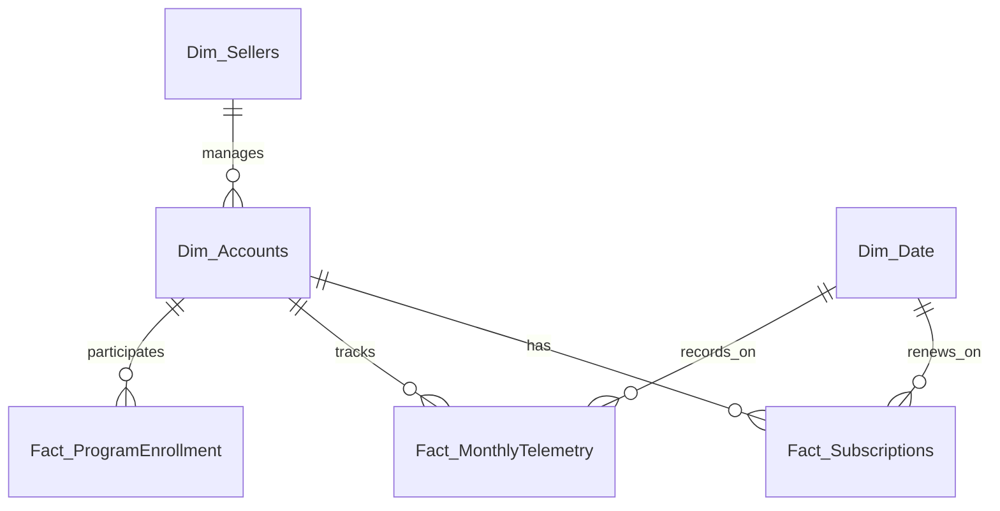

# Power BI Data Model Architecture & DAX Measures

## 1. Star Schema Architecture



### Tables & Relationships
* **Dim_Accounts**: `account_id` (PK), `account_name`, `tier`, `industry`, `region`, `baseline_arr`, `assigned_seller_id`
* **Dim_Sellers**: `seller_id` (PK), `seller_name`, `region`, `tenure_months`, `annual_quota`
* **Fact_Subscriptions**: `subscription_id` (PK), `account_id` (FK), `fiscal_year`, `contract_value_arr`, `prior_year_arr`, `renewal_status`, `expansion_arr`, `churn_arr`
* **Fact_MonthlyTelemetry**: `account_id` (FK), `metric_month`, `licensed_seats`, `active_users`, `seat_utilization_pct`, `portal_logins`, `research_downloads`, `analyst_inquiries`, `executive_sponsor_engaged`
* **Fact_ProgramEnrollment**: `account_id` (FK), `program_id`, `cohort_type`, `is_treated`, `completed_program`, `intervention_cost`

---

## 2. Production DAX Measures

### A. Retention & Revenue Metrics
```dax
-- Total Starting Base ARR (Prior Year ARR for accounts renewing in selected period)
Starting Base ARR = 
CALCULATE(
    SUM(Fact_Subscriptions[prior_year_arr]),
    Fact_Subscriptions[fiscal_year] = 2025
)

-- Ending ARR (Actual renewed & expanded revenue)
Ending ARR = 
CALCULATE(
    SUM(Fact_Subscriptions[contract_value_arr]),
    Fact_Subscriptions[fiscal_year] = 2025
)

-- Retained ARR Base (Excludes expansions, capped at prior contract value)
Retained Base ARR = 
CALCULATE(
    SUMX(
        Fact_Subscriptions,
        IF(
            Fact_Subscriptions[renewal_status] IN {"Renewed", "Expanded"},
            Fact_Subscriptions[prior_year_arr],
            Fact_Subscriptions[contract_value_arr]
        )
    ),
    Fact_Subscriptions[fiscal_year] = 2025
)

-- Gross Revenue Retention (GRR %) - Target > 85%
GRR % = 
DIVIDE([Retained Base ARR], [Starting Base ARR], 0)

-- Net Revenue Retention (NRR %) - Target > 105%
NRR % = 
DIVIDE([Ending ARR], [Starting Base ARR], 0)

-- Churned ARR
Churned ARR = 
CALCULATE(
    SUM(Fact_Subscriptions[churn_arr]),
    Fact_Subscriptions[fiscal_year] = 2025
)

-- Logo Churn %
Logo Churn % = 
VAR TotalAccounts = COUNTROWS(Fact_Subscriptions)
VAR ChurnedAccounts = CALCULATE(COUNTROWS(Fact_Subscriptions), Fact_Subscriptions[renewal_status] = "Churned")
RETURN
DIVIDE(ChurnedAccounts, TotalAccounts, 0)
```

### B. Client Health & Risk Measures
```dax
-- Current Average Seat Utilization %
Avg Seat Utilization = 
AVERAGE(Fact_MonthlyTelemetry[seat_utilization_pct])

-- Accounts at Critical Churn Risk (Health Score < 45)
Critical Risk Accounts = 
CALCULATE(
    DISTINCTCOUNT(Dim_Accounts[account_id]),
    FILTER(
        Dim_Accounts,
        [Avg Seat Utilization] < 0.40
    )
)

-- Revenue at Risk ($ in critical health accounts)
Revenue at Risk = 
CALCULATE(
    SUM(Dim_Accounts[baseline_arr]),
    FILTER(
        Dim_Accounts,
        [Avg Seat Utilization] < 0.40
    )
)
```

### C. GSSO Program Effectiveness & ROI Measures
```dax
-- Treatment Renewal Rate %
Treatment Renewal Rate % = 
VAR RenewedTreated = 
    CALCULATE(
        COUNTROWS(Fact_Subscriptions),
        Fact_Subscriptions[renewal_status] IN {"Renewed", "Expanded"},
        Fact_ProgramEnrollment[completed_program] = 1
    )
VAR TotalTreated = 
    CALCULATE(
        COUNTROWS(Fact_ProgramEnrollment),
        Fact_ProgramEnrollment[completed_program] = 1
    )
RETURN
DIVIDE(RenewedTreated, TotalTreated, 0)

-- Control Renewal Rate %
Control Renewal Rate % = 
VAR RenewedControl = 
    CALCULATE(
        COUNTROWS(Fact_Subscriptions),
        Fact_Subscriptions[renewal_status] IN {"Renewed", "Expanded"},
        Fact_ProgramEnrollment[cohort_type] = "Control"
    )
VAR TotalControl = 
    CALCULATE(
        COUNTROWS(Fact_ProgramEnrollment),
        Fact_ProgramEnrollment[cohort_type] = "Control"
    )
RETURN
DIVIDE(RenewedControl, TotalControl, 0)

-- Program Incremental Lift %
Program Incremental Lift % = 
[Treatment Renewal Rate %] - [Control Renewal Rate %]
```

---

## 3. Executive Dashboard Layout Specification

### Page 1: GSSO Executive Renewal & Revenue Command Center
* **Top KPI Cards**: Total Contract Value ($45.2M), Gross Revenue Retention (86.4%), Net Revenue Retention (108.2%), Logo Churn (13.8%).
* **Visual 1 (Area Chart)**: Monthly Ending ARR vs Baseline ARR by Tier.
* **Visual 2 (Matrix)**: Region & Tier Retention Matrix (Accounts, Starting ARR, Retained ARR, GRR %, NRR %).
* **Visual 3 (Waterfall Chart)**: Revenue Walk (Starting ARR + Expansion - Downsell - Churn = Ending ARR).

### Page 2: Client Engagement & Churn Diagnostics (90-Day Warning Radar)
* **Top KPI Cards**: Accounts Monitored (1,200), Accounts in Red Zone (142), Total Revenue at Risk ($6.8M).
* **Visual 1 (Scatter Plot)**: Seat Utilization % (X-axis) vs Analyst Inquiries (Y-axis), bubble size = Baseline ARR, color = Churn Status.
* **Visual 2 (Table)**: At-Risk Account Action List (Account Name, Tier, ARR, Health Score, Recommended Playbook Action).

### Page 3: Program Effectiveness & Seller Productivity
* **Left Section (GSSO Program Evaluation)**:
  * Clustered Bar: Treatment Renewal Rate (92.4%) vs Control Renewal Rate (83.3%).
  * Callout Card: Net Retained ARR Lift ($4.14M), Program ROI (980%).
* **Right Section (Seller Productivity)**:
  * Scatter Plot: Monthly Sales Activities vs Quota Attainment % (isolates top performers).
  * Bar Chart: Quota Attainment % by Tenure Tier (Ramping vs Tenured).
