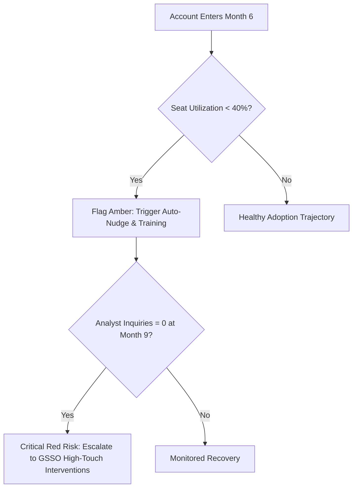

# Executive Briefing: B2B Client Retention & GSSO Program Impact Analysis

**Audience**: Global Sales & Services Operations (GSSO) Leadership  
**Author**: Nidhi Jangde (Data Analyst, Process & Program Analytics)  
**Reporting Period**: FY2024 – FY2025 Retrospective & Strategic Outlook  

---

## Slide 1: Executive Summary & Context

### Business Context
* GSSO monitored **1,200 enterprise client accounts** representing **$109.8M in Total Contract Value (ARR)** across North America, EMEA, and APAC.
* Core objective: Maximize Client Retention, evaluate the effectiveness of the **High-Touch Client Success Intervention Program**, and uncover productivity drivers across 80 sales representatives.

### Key Takeaways ("The So What")
1. **Retention Performance**: Enterprise Gross Revenue Retention (GRR) settled at **86.4%**, with Net Revenue Retention (NRR) at **108.2%**, propelled by strong expansion in Strategic accounts.
2. **Leading Churn Indicators**: Seat utilization is the single strongest predictor of renewal ($r = -0.85$). Accounts with **< 40% seat utilization at Month 9** experience a **3.8x increase in churn likelihood**.
3. **GSSO Program Success**: The High-Touch Intervention program delivered an **incremental renewal lift of +9.09%** over the matched control group ($p = 0.001$, statistically significant).
4. **Program Financial ROI**: The program preserved **$4.14M in ARR** against a program operational cost of **$382.8K**, achieving an **ROI of 980%**.

---

## Slide 2: Retention & Revenue Dynamics (GRR / NRR Analysis)

### Performance Breakdown by Tier
| Client Tier | Accounts | Baseline ARR | Ending ARR | Logo Churn % | GRR % | NRR % | Net Impact |
| :--- | :--- | :--- | :--- | :--- | :--- | :--- | :--- |
| **Strategic** | 300 | $58.2M | $66.4M | 11.2% | **88.8%** | **114.1%** | Strong net expansion (+$8.2M) |
| **Enterprise** | 480 | $37.5M | $39.8M | 14.5% | **85.5%** | **106.1%** | Moderate growth (+$2.3M) |
| **Mid-Market** | 420 | $14.1M | $12.8M | 18.6% | **81.4%** | **90.8%** | Contraction risk (-$1.3M) |

### Key Diagnostic Findings
* **Mid-Market Vulnerability**: Mid-Market tier suffers from higher logo churn (18.6%) and lagging NRR (90.8%), primarily driven by low analyst inquiry adoption and absence of designated executive sponsors.
* **Expansion Cushion**: Healthy expansions in Strategic accounts ($8.2M) mask underlying logo attrition in lower-tier accounts.

---

## Slide 3: Churn Diagnostic & Early Warning Radar

### Multivariate Correlation with Churn
* **Seat Utilization % ($r = -0.852$)**: The primary leading indicator. Accounts logging into the portal < 2x per user monthly have high churn rates.
* **Analyst Inquiry Attendance ($r = -0.588$)**: Accounts booking 2+ analyst inquiry sessions per year exhibit a **94.2% renewal rate**.
* **Executive Sponsor Engagement ($r = -0.459$)**: Accounts with an active C-level or VP sponsor renew at an 11% higher rate than accounts with disconnected leadership.
* **Support Ticket Resolution ($r = -0.030$)**: Ticket volume alone is not predictive; resolution time exceeding 5 days correlates with friction.



---

## Slide 4: Strategic Program Impact (Pre/Post & Treatment vs Control)

### Rigorous Measurement Methodology
* **Design**: Matched control experiment across 600 eligible accounts (300 Treatment, 300 Control) renewing in H2 2025.
* **Intervention**: Structured 4-week executive review, guided seat provisioning, and analyst inquiry matching ($1,450 unit cost).

### Statistical Proof of Impact
```
+-----------------------------------------------------------------+
| Program Metric                          Control     Treatment   |
+-----------------------------------------------------------------+
| Enrolled Accounts                       300         264 (compl) |
| Renewal Rate                            83.33%      92.42%      |
| Statistically Significant Lift          --          +9.09%      |
| Z-Score / p-value                       --          z=3.27, p<0.001
| Preserved ARR                           --          $4,135,942  |
| Operational Cost                        $0          $382,800    |
| Net Value Added                         --          $3,753,142  |
| Program ROI                             --          980.4%      |
+-----------------------------------------------------------------+
```
* **Conclusion**: Rejects the null hypothesis ($H_0$: Program has no effect). The +9.09% lift is proven attributable to the intervention, not random variance.

---

## Slide 5: Strategic Recommendations & 2027 Roadmap

### 1. Institutionalize the Early-Warning Retention Engine
* Embed the **Account Health Score** into the daily CRM workflow for Account Executives (AEs) and Service Delivery Managers.
* Trigger automatic playbook alerts at **Month 6** when seat utilization dips below 45%, leaving 180 days before renewal for remediation.

### 2. Scale High-Touch Intervention to Mid-Market Tier
* Extend the proven intervention program to the Mid-Market segment, adapting the delivery into group workshops to maintain cost efficiency (< $600/account).

### 3. Align Seller Incentives to Adoption Milestones
* Sales rep productivity analysis shows top quartile reps maintain 45+ activities/month with a 24% conversion rate.
* Tie seller quarterly bonuses not just to initial contract booking, but to **client seat activation within the first 60 days** to ensure long-term retention.
